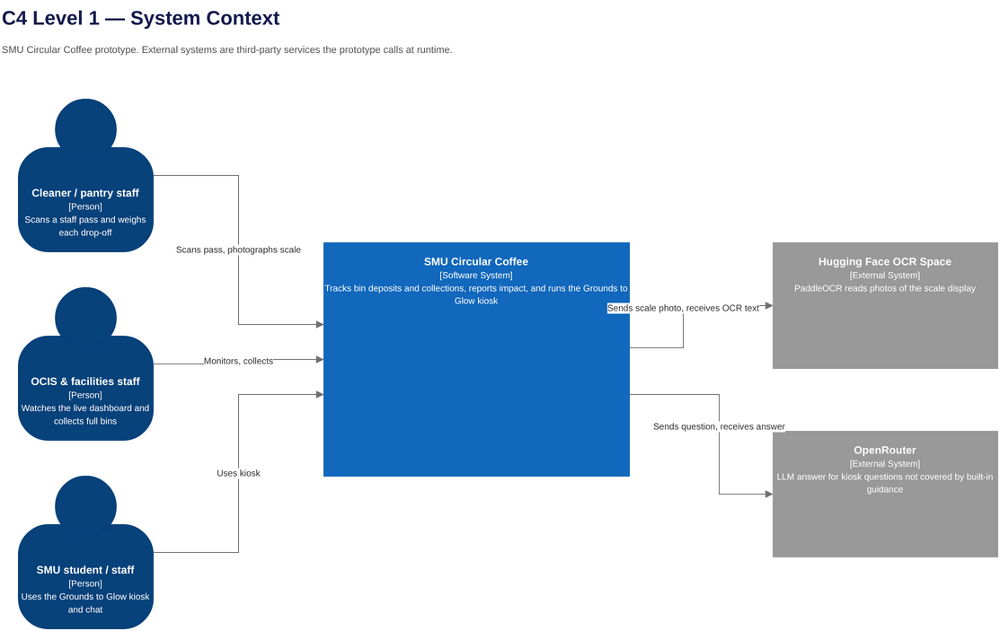
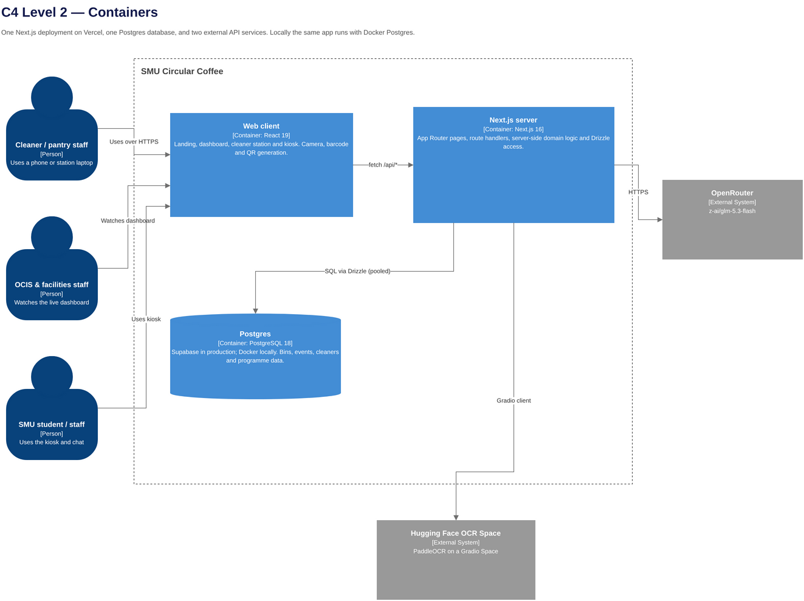
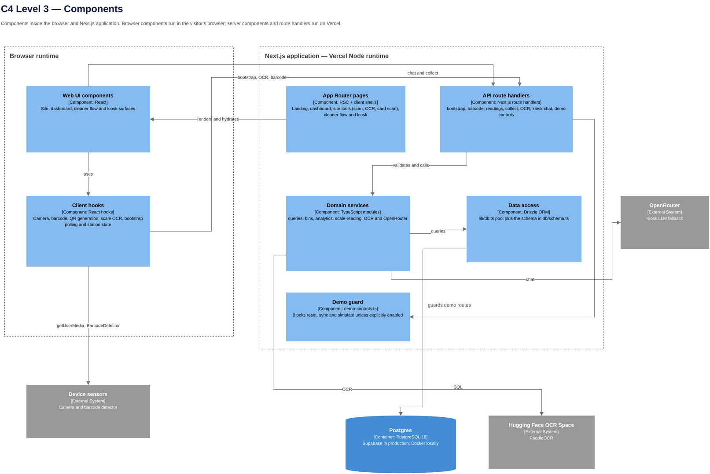

# Architecture

SMU Circular Coffee is a Next.js prototype for tracking spent coffee grounds and running the
Grounds to Glow kiosk. This document describes the system as it is implemented, the runtime flows,
the data model, and the sustainability choices behind it.

- **Status:** working prototype for the IS463 demo; not a production service. This description is a
  snapshot of the code on 9 November 2026.
- **Stack:** Next.js 16.4.5 (App Router), React 19.3.1, TypeScript, Tailwind CSS 4, Drizzle ORM
  0.45, Postgres 18, Bun 1.4.
- **Runtime:** Vercel for the Next.js app; Supabase Postgres in production; Docker Postgres locally.
- **External services:** Hugging Face PaddleOCR Space (scale photos) and OpenRouter (kiosk chat).

## 1. System context

*Source: [`diagrams/c4-context.drawio`](diagrams/c4-context.drawio) · [`SVG`](diagrams/c4-context.svg)*

| Actor / system | Role |
| --- | --- |
| Cleaner / pantry staff | Scans a staff pass, chooses the pantry level, photographs the scale |
| OCIS & facilities staff | Watches the live dashboard, checks fill levels, collects full bins |
| SMU student / staff | Uses the Grounds to Glow kiosk and chat |
| Hugging Face OCR Space | Reads the scale display with PaddleOCR |
| OpenRouter | Answers kiosk questions that the built-in guidance does not cover |

The prototype is software only. The "smart bin" in the product story is represented by a station
laptop or phone that photographs a floor scale; there is no embedded load cell or bin sensor in the
running prototype. The proposed hardware (Raspberry Pi, load cell, touch display, solar dehydrator)
is a design concept, not part of this deployment.

## 2. Containers

*Source: [`diagrams/c4-container.drawio`](diagrams/c4-container.drawio) · [`SVG`](diagrams/c4-container.svg)*

| Container | Responsibility |
| --- | --- |
| Web client (React 19) | Landing, dashboard, cleaner flow and kiosk. Camera capture, barcode scanning and local QR generation. |
| Next.js server | App Router pages, route handlers, server-side domain logic and Drizzle access. |
| Postgres | Operational data and programme metrics. Supabase in production; Docker locally. |

| External system | Responsibility |
| --- | --- |
| Hugging Face OCR Space | PaddleOCR service behind a Gradio API. |
| OpenRouter | LLM fallback for kiosk chat (`z-ai/glm-5.3-flash`). |

The browser and the Next.js server are separate runtimes even though one repository builds both.
Most data surfaces fetch `/api/bootstrap` from client components. The landing page polls it for the
live demo; the dashboard fetches on open, on tab focus and on demand. The route caches a 15-second
snapshot in Upstash Redis when configured, so repeated landing polls do not hit Postgres. Static
route shells are prerendered where possible.

## 3. Components

*Source: [`diagrams/c4-component.drawio`](diagrams/c4-component.drawio) · [`SVG`](diagrams/c4-component.svg)*

| Component | Location | Responsibility |
| --- | --- | --- |
| App Router pages | `app/**/page.tsx` | Route entry points for the site, cleaner flow and kiosk |
| Web UI components | `components/**` | SMU chrome, landing sections, dashboard, cleaner station, kiosk, AI elements |
| Client hooks | `lib/client/**` | Camera, barcode scanner, QR generation, scale OCR, bootstrap polling, station state |
| API route handlers | `app/api/**/route.ts` | Validation and HTTP boundary for all reads and writes |
| Domain services | `lib/queries.ts`, `lib/bins.ts`, `lib/analytics.ts`, `lib/scale-reading.ts`, `lib/ocr.ts`, `lib/openrouter.ts` | Business rules, calculations, OCR and chat integration |
| Data access | `lib/db.ts`, `db/schema.ts` | Lazy pool creation, Drizzle client and schema |
| Demo guard | `lib/demo-controls.ts` | Turns off destructive demo routes unless explicitly enabled |

## 4. Runtime flows

### 4.1 Cleaner deposit

1. `/cleaner` starts the camera and scans a staff-pass barcode with `BarcodeDetector`, or accepts a
   typed pass number. `POST /api/barcode/resolve` looks up `cleaners.pass`.
2. `/cleaner/building` shows the building's pantry levels. The station bin is remembered in
   `localStorage` after a one-time `?station=<bin-id>` setup.
3. `/cleaner/weigh` obtains a scale photo: sample frame, uploaded image or typed weight. The browser
   crops and downscales the photo, then `POST /api/ocr/scale` sends it to the OCR Space and parses the
   reading with `lib/scale-reading.ts`.
4. `POST /api/readings` calls `createReading()`. Inside one transaction it locks the bin row
   (`SELECT ... FOR UPDATE`), clamps `afterKg` to `[0, capacity_kg]`, rejects a reading that is not
   above the current total, stores a `deposit` event with `before_kg`/`after_kg`, and updates the bin
   weight. The floor scale reports the running total, so the event weight is the difference. An
   over-capacity reading is recorded as a full bin; a reading on a full bin is rejected with 409.

### 4.2 Collection

The dashboard sends `POST /api/collect`. `collectBin()` locks the bin, rejects an empty bin, writes a
`collect` event with the removed weight and `collected_by`, and resets the bin to zero.

### 4.3 Live dashboard and landing page

`GET /api/bootstrap` returns bins, events, cleaners, news, programme events and metrics. The landing
page polls it every four seconds for the live demo. The dashboard does not poll: it fetches on open,
refreshes when the tab regains focus, and has an explicit Refresh button that adds `?refresh=1` to
bypass the cache. Both show the snapshot's `updatedAt` time.

Without Redis, every request queries Postgres. With Upstash configured, the route returns a cached
snapshot for up to 15 seconds; a cache miss (or a bypass) reads Postgres, stamps `updatedAt` and
writes the snapshot back. Deposits, collections, demo sync/simulate and reset delete the key, so a
manual refresh after a write sees the new reading. New events are detected by comparing event IDs,
so the live toast only fires for cleaner-attributed deposits with a source of `ocr`, `reference` or
`manual` that arrive after mount; sync, demo and collection events do not toast.

### 4.4 Kiosk chat

The kiosk first tries `getBuiltInGuidance()` in `components/kiosk/kiosk-chat.tsx`. Common questions
about the project, recipes, cost, safety, storage and the circular loop get deterministic answers
without a network call or LLM. Anything else goes to `POST /api/kiosk-chat`, which:

- limits each IP to 30 messages per minute (in-memory, per server instance);
- rejects prompts over 2,000 characters;
- sends a kiosk-specific system prompt to OpenRouter with `temperature: 0.4`, `max_tokens: 600` and a
  25-second timeout;
- returns a 503 with a friendly message when the key is missing or the upstream call fails.

If `OPENROUTER_API_KEY` is unset, matching questions still get the built-in guidance; unmatched
questions show the offline message.

### 4.5 OCR

`POST /api/ocr/scale` is the only real OCR route. It accepts PNG, JPEG or WebP up to 4 MB, calls the
Gradio client in `lib/ocr.ts`, and takes the first number on the tallest OCR line. The scale display's
unit is read from the photo when possible; otherwise the station's `?scale=g` setting is used, with a
capacity-based fallback.

A sleeping Hugging Face Space takes time to wake. The route allows 60 seconds, the client retries
every 8 seconds for up to 120 seconds on a `503 waking` response, and `/api/ocr/warm` starts the
Space when the cleaner reaches the check-in page. The Space sleeps after two days without use.

`/scan` and `/ocr` are demo tools and use the simulated OCR in `lib/demo-ocr.ts`; they are not the
cleaner weigh path.

### 4.6 Demo controls

`NEXT_PUBLIC_DEMO_CONTROLS=true` exposes Reset, Sync and Simulate in the UI and enables their routes.
Otherwise `POST /api/reset`, `POST /api/sync` and `POST /api/simulate` return 403. Reset reseeds the
database from `scripts/seed.ts`; Sync inserts one random reading; Simulate inserts a reading and
auto-collects the oldest full bin when two bins are full.

## 5. Data model

The full Mermaid ERD, table status and constraints are in [ERD.md](ERD.md). The active tables are
`bins`, `cleaners`, `bin_events` and `programme_metrics`. `news_items` and `programme_events` are
seeded but no longer surfaced; `listings` and `claims` are legacy marketplace tables that are neither
seeded nor read.

Two application rules are worth calling out here:

- `createReading()` and `collectBin()` run in a transaction with `SELECT ... FOR UPDATE` on the bin
  row, so two live controls cannot overwrite each other's weight.
- Weights are stored as `numeric(7,3)` (gram precision), and `scripts/check-seed.ts` replays the
  event history to verify that it ends at the bin's current weight.

## 6. API surface

| Route | Method | Purpose | Guard |
| --- | --- | --- | --- |
| `/api/bootstrap` | GET | All data needed by client surfaces | — |
| `/api/barcode/resolve` | POST | Resolve a staff pass or card barcode | — |
| `/api/ocr/scale` | POST | Read a scale display with PaddleOCR | — |
| `/api/ocr/warm` | POST | Start waking the OCR Space | — |
| `/api/readings` | POST | Record a deposit and update the bin | — |
| `/api/collect` | POST | Empty a bin and write an audit event | — |
| `/api/sync` | POST | Insert one simulated remote reading | Demo controls |
| `/api/simulate` | POST | One demo live-day step, including auto-collect | Demo controls |
| `/api/kiosk-chat` | POST | Grounds to Glow chat via OpenRouter | Rate limit |
| `/api/reset` | POST | Reseed the database | Demo controls |

## 7. Rendering, caching and performance

- `next.config.ts` enables `cacheComponents` and `partialPrefetching`, and configures the Tailwind
  Turbopack loader.
- Route shells that only read search parameters are wrapped in `Suspense` so they can prerender
  (for example the kiosk and dashboard). The build uses partial prerendering: every page has a
  prerendered shell, and `/cleaner/building`, `/cleaner/weigh`, `/dashboard` and `/kiosk` stream the
  dynamic remainder. All `/api/*` routes are dynamic.
- `next/font` self-hosts Oswald and Libre Franklin at build time, avoiding runtime font requests.
- `next/image` serves the landing images with responsive `sizes`; images are lazy by default, with
  an eager/high-priority option in `ScaleReadout` for a hero-style image.
- The barcode decoder is dynamically imported only when a camera starts, keeping it out of the
  initial bundle. QR codes are generated locally with the `qrcode` package, not fetched from an
  image service.
- Tailwind CSS is compiled at build time; icon imports come from `lucide-react` and are tree-shaken.
- Chart animations are disabled and `prefers-reduced-motion` turns off transitions globally.
- `useNow` wakes every 30 seconds and publishes a minute-rounded value, so it re-renders at most once
  a minute; barcode scanning is throttled to 250 ms with a two-read confirmation.
- The database pool is created lazily and reused globally (`max: 5`, `idleTimeoutMillis: 30_000`), so
  importing a route during `next build` does not require credentials and serverless instances do not
  open a new pool per request.
- Live reads use `cache: "no-store"` in the browser because stale bin weights would be wrong. The
  server adds a 15-second Upstash snapshot cache in front of Postgres for `/api/bootstrap`; a
  `?refresh=1` request bypasses it, and writes delete the key. Static assets and fonts use the
  framework's normal caching.

## 8. Security, privacy and reliability

- **No user accounts or sessions.** The prototype is a demo. There is no middleware, login or
  authorization layer. `POST /api/readings` and `POST /api/collect` accept unauthenticated writes,
  and the OCR endpoints are public. Keep the deployment URL private during assessment, or put a
  shared-secret proxy in front of it before exposing it widely.
- **Demo controls are a switch, not a security boundary.** `NEXT_PUBLIC_DEMO_CONTROLS=true` exposes
  Reset, Sync and Simulate. The client visibility is inlined at build time; the server 403 guard reads
  `process.env.NEXT_PUBLIC_DEMO_CONTROLS` at runtime. A runtime-only change can therefore leave the UI
  and the API guard disagreeing, so rebuild and verify both after any change.
- **The full cleaner roster reaches the browser.** `/api/bootstrap` includes every cleaner and their
  pass number because the UI uses the roster for the passes page and check-in. The barcode resolver
  is therefore not a confidentiality boundary. Do not put real staff data in the demo database.
- **Cleaner identity is a query parameter.** After check-in, `/cleaner/building?cleaner=<id>` and
  `/cleaner/weigh?cleaner=<id>` trust the ID. Anyone can open a weigh URL with another cleaner's ID;
  the API only checks that the cleaner exists. This is acceptable for a demo, not for operations.
- **Hardcoded real card.** A real SMU card number is hardcoded in `lib/queries.ts` and maps to demo
  cleaner `c-0142`; the number is kept out of `bin_events`, not out of the codebase. Move it to
  server-side configuration before using a real card in anything shared.
- **Secrets stay server-side.** `OPENROUTER_API_KEY` and `HF_TOKEN` are only read in server modules.
- **Barcode values are not logged.** The resolve route logs only unexpected errors, because scanned
  values can be real ID numbers. The card scanner keeps photos in the browser.
- **Upload validation.** OCR accepts only PNG/JPEG/WebP and rejects images over 4 MB. The route reads
  the multipart body before checking the size, so a very large request can still be buffered; the
  platform body limit is the backstop.
- **SQL is parameterised** through Drizzle; row locks and transactions prevent conflicting bin
  updates. SSL is inferred for Supabase/pooler URLs or forced with `DATABASE_SSL=true`; certificate
  verification is disabled for every SSL connection (`rejectUnauthorized: false`), not only the
  pooler.
- **Rate limiting is partial.** Only kiosk chat is limited (30 requests/minute/IP), and the bucket is
  in memory per server instance. The OCR and reading routes have no limiter.
- **Failure behaviour.** A 503 `waking` response carries the retry hint; a 502 upstream failure does
  not. Chat returns 503 and the UI keeps the built-in answers. Bootstrap/reset/sync/simulate return
  generic 500s, but readings and collect return the exception message with a 400.
- **Not implemented:** authentication, CSRF tokens, durable rate limiting across instances, security
  headers/CSP, a health endpoint and structured observability. Treat the deployment as a demo.

## 9. Green computing

The prototype follows sustainable software engineering where it can without weakening the demo. The
principles below are from the Green Software Foundation vocabulary: carbon efficiency, energy
efficiency, carbon awareness, hardware efficiency and measurement. This section separates what is
implemented from what is only a design target.

### 9.1 Principles and patterns applied

| Principle | What the prototype does | Evidence |
| --- | --- | --- |
| **Carbon efficiency** | One shared Next.js deployment and one managed database instead of a server per bin or building. Vercel runs the app on demand rather than keeping an always-on VM for the prototype. | `next.config.ts`, `.github/workflows/deploy.yml`; seven shared bins in `scripts/seed.ts` |
| **Energy efficiency** | Deterministic kiosk answers avoid an LLM call for common questions. OCR runs only when a cleaner weighs a bin, not on a timer. Photos are cropped and downscaled before upload. | `getBuiltInGuidance()` in `components/kiosk/kiosk-chat.tsx`; `MAX_SIDE = 1600` and JPEG quality 0.9 in `lib/client/scale-ocr.ts` |
| **Energy efficiency** | Live polling is limited to the landing demo; the dashboard refreshes on open, tab focus and an explicit button. The 15-second Upstash snapshot absorbs repeated landing polls and cuts Postgres reads. | `app/(site)/page.tsx`; `components/dashboard/dashboard-client.tsx`; `lib/cache.ts` |
| **Energy efficiency** | The barcode decoder is dynamically imported only when a camera starts, chart animations are disabled, and `useNow` wakes every 30 seconds to publish a minute-rounded value. | `lib/client/use-barcode-scanner.ts`, `components/ui/chart-card.tsx`, `lib/client/use-now.ts` |
| **Hardware efficiency** | The browser supplies the camera and barcode detector, so the prototype needs no dedicated scanner hardware for the demo. QR codes are generated locally rather than fetched. | `lib/client/use-barcode-scanner.ts`, `lib/client/camera.ts`, `lib/client/use-qr.ts` |
| **Hardware efficiency** | Local development uses one Docker Postgres container; production uses managed Supabase rather than a dedicated database VM. | `docker-compose.yml`, `lib/db.ts` |
| **Data efficiency** | One aggregate `/api/bootstrap` request supplies all client surfaces instead of many small calls. `getEvents(limit)` supports bounded history reads. | `app/api/bootstrap/route.ts`, `lib/queries.ts` |
| **Data efficiency** | The OCR upload cap, image downscaling and `max_tokens: 600` for chat keep payloads and model work small. The OCR route stores no uploaded photo by default. | `lib/languages.ts`, `lib/client/scale-ocr.ts`, `lib/openrouter.ts` |
| **Data efficiency** | Analytics and CSV export are computed client-side from the bootstrap payload. Reset reseeds and re-queries Postgres server-side but returns the fresh payload in the same response, avoiding a follow-up API call. | `lib/analytics.ts`, `lib/client/csv.ts`, `app/api/reset/route.ts` |
| **Data minimisation** | No third-party analytics or tracking scripts. The barcode route does not log scanned values. Only the scale photo or a crop is sent to OCR. | `app/api/barcode/resolve/route.ts`; no analytics dependency in `package.json` |
| **Database efficiency** | A small reused connection pool, targeted indexes, row-level locks and transactions avoid repeated connections and conflicting writes. Bootstrap runs six queries in parallel. | `lib/db.ts`, `db/schema.ts`, `getBootstrap()`/`createReading()`/`collectBin()` in `lib/queries.ts` |
| **Asset efficiency** | Fonts are self-hosted at build time; landing images use `next/image` with responsive sizes and lazy loading by default; `prefers-reduced-motion` turns off transitions. | `app/layout.tsx`, `components/landing/shared.tsx`, `app/globals.css` |
| **Longevity** | Migrations, a deterministic seed and a data-integrity check keep the prototype reproducible; the dependency set is small. | `db/migrations/`, `scripts/seed.ts`, `scripts/check-seed.ts` |

### 9.2 Design-stage carbon estimate

The working notes in the project workspace (`scratch-notes.md`, November 2026) contain a design-stage
estimate for the proposed hardware and service model. It compares the current food-waste baseline
with the circular solution:

| Item | Estimate |
| --- | ---: |
| Food-waste incineration baseline | 793.12 kg CO2e/year |
| Circular solution (hardware, cloud, kiosk, consumables) | 350.79 kg CO2e/year |
| Estimated saving | 442.33 kg CO2e/year (55.77%) |
| of which embodied carbon | 57.51 kg CO2e/year |

These figures come from the working notes in the project workspace and mix hardware, energy, AI and
consumable assumptions. They are **not measurements of the deployed software**. The deployed
prototype does not include the Raspberry Pi, load cell, touch display or solar dehydrator in the
hardware concept, and no runtime energy telemetry is collected. Treat the table as a design estimate
to be re-checked before it is quoted externally.

### 9.3 Known gaps and next steps

- **Unbounded bootstrap payload.** `/api/bootstrap` returns every event, every cleaner (including
  pass numbers) and the seeded news/programme tables even though the current UI does not surface
  news or programme events. The seeded history alone is hundreds of events; the deployed payload was
  measured at about 81 KB during the deployment audit and grows with every reading. Limit events to
  the reporting window, project only the fields the UI needs, and remove the unused queries.
- **Polling cost.** The landing page still polls every four seconds while open. Pause polling when the
  tab is hidden or back off when the data is unchanged. The dashboard no longer polls, so most idle
  traffic is already gone.
- **Cache granularity and privacy.** The 15-second cache stores the whole bootstrap payload, including
  the demo cleaner pass list, and a single key serves every caller. Split the hot bin/status data from
  the cold analytics, cache only fields the caller needs, and avoid caching real staff data.
- **Legacy tables.** `listings` and `claims` are still in the schema and migrations. Dropping them
  reduces storage, backup size and migration time. `news_items` and `programme_events` can be removed
  once their seed data is no longer needed.
- **Duplicate and oversized images.** `public/images/weighing_scale_*.jpeg` are about 3.3 MB each and
  are duplicated at the `public/` root; the campus map is also duplicated. Several other images are
  leftovers from removed news/programme sections. Keep one optimised copy of each asset.
- **Landing bundle.** The landing page statically imports the kiosk chat, which brings
  `react-markdown`, `remark-gfm` and the chat UI into the initial home route. Load it with
  `next/dynamic` when it scrolls into view.
- **OCR cold starts.** A sleeping PaddleOCR Space spends energy starting up. The hardware concept can
  read the load cell directly and remove cloud OCR entirely; until then, warm the Space only when a
  cleaner is actually at the station. The current timeout also does not abort the underlying Gradio
  request, so a timed-out attempt can keep running while the retry starts.
- **Open endpoints.** `/api/ocr/*`, `/api/readings` and `/api/collect` can be called by anyone who
  finds the URL. Spam requests waste Hugging Face quota, database work and energy. Add a shared
  secret or a rate limiter before exposing the demo beyond the assessment.
- **Answer caching.** Common LLM answers could be cached with a short TTL instead of calling
  OpenRouter again for the same question.
- **Region placement.** The current Vercel functions run in `iad1` (US East) while the Supabase
  database is in `eu-central-1` and users are in Singapore. Choosing a nearer region for both would
  cut network latency and energy. See [DEPLOYMENT.md](DEPLOYMENT.md) for the observed topology.
- **Carbon awareness.** The app does not shift work to low-carbon hours or regions; the demo must
  respond immediately. This is not implemented, and it is not claimed in the table above.
- **Measurement.** Add request counts, payload sizes and, where the platform exposes it, energy or
  carbon estimates. Without measurement, the green claims stay design intent.

## 10. Known constraints

- The demo uses seven building bins and 33 pantry levels; this is a prototype abstraction, not the
  27 machines described in the OCIS research notes.
- Impact metrics on the landing page are seeded demo values, not measured savings.
- The kiosk rate limiter is in-memory and per instance; it is not a durable abuse control.
- Production database migrations and seeding are manual steps; the deploy workflow only ships code.
  See [DEPLOYMENT.md](DEPLOYMENT.md).
