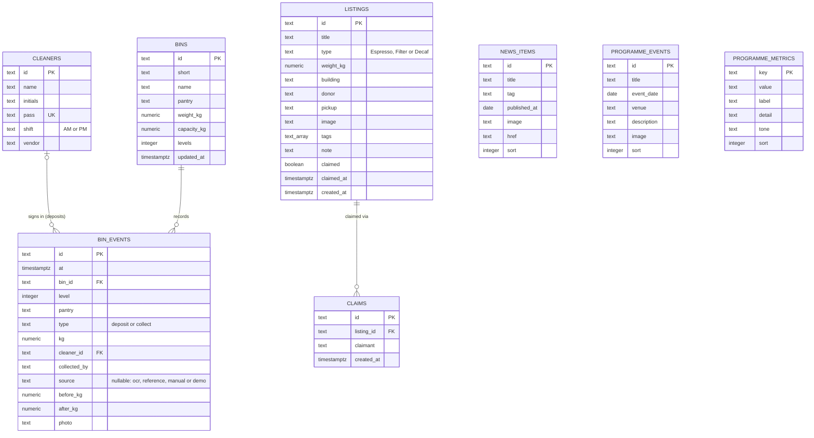

# Entity-relationship diagram

The schema is defined in [`db/schema.ts`](../db/schema.ts) and applied by the migrations in
[`db/migrations/`](../db/migrations/). The diagram is Mermaid source so GitHub renders it directly.

## Table status

| Table | Status | Notes |
| --- | --- | --- |
| `bins` | Active | Seven building bins; current weight, capacity and pantry levels |
| `cleaners` | Active | Demo staff roster and unique pass numbers |
| `bin_events` | Active | Deposits and collections; the audit trail behind every weight |
| `programme_metrics` | Active | Landing impact cards; seeded demo values |
| `news_items` | Seeded, not surfaced | No current UI |
| `programme_events` | Seeded, not surfaced | No current UI; some seeded dates are upcoming |
| `listings` | Legacy, unused | Removed marketplace; not seeded or read |
| `claims` | Legacy, unused | Removed marketplace; not seeded or read |

## Constraints and indexes

- `cleaners.pass` is unique; `cleaners.shift` is `AM` or `PM`.
- `bins.weight_kg >= 0`, `bins.capacity_kg > 0` and `bins.levels > 0`.
- `bin_events.type` is `deposit` or `collect`; `kg >= 0`; `source` is nullable, and deposits set
  `ocr`, `reference`, `manual` or `demo` while collection events leave it null.
- `bin_events.bin_id` references `bins.id` with `ON DELETE CASCADE`; `bin_events.cleaner_id`
  references `cleaners.id` with `ON DELETE SET NULL`.
- Indexes: `bin_events(bin_id, at desc)`, `bin_events(at desc)`, `listings(created_at desc)`.
- Weights are `numeric(7,3)` so stored values keep gram precision. The ERD uses `text_array` as a
  diagram alias for the Postgres `text[]` type on `listings.tags`.

The application writes a deposit and updates the bin in one transaction with a row lock. The history
therefore remains consistent even when two demo controls run at once. `bun run db:check` replays the
event chain and verifies that it ends at each bin's current weight.
